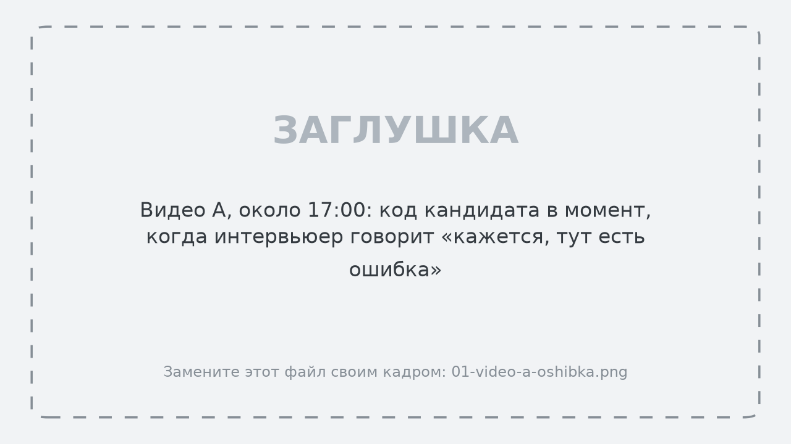
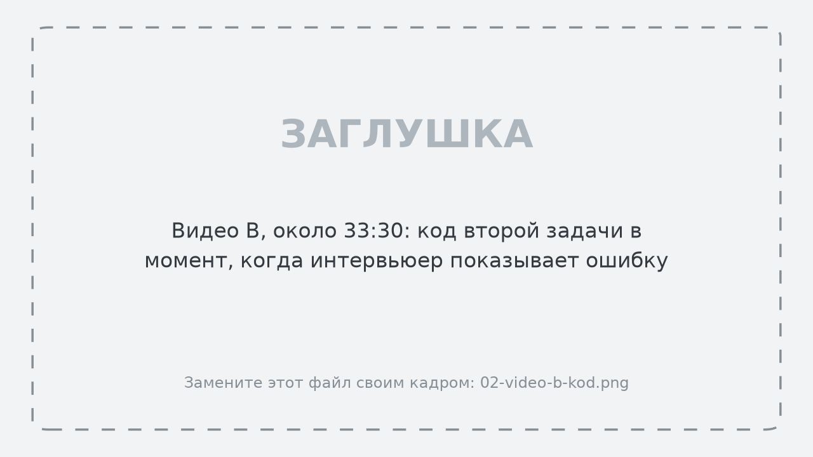

# Домашняя работа № 6 · Как проходит алгоритмическое собеседование

**Дисциплина:** ОП.04 «Основы алгоритмизации и программирования»

| Поле | Значение |
|---|---|
| Фамилия, имя, отчество |  |
| Группа |  |
| Номер работы | 6 |
| Тема работы | Разбор двух записей алгоритмических собеседований |
| Дата сдачи |  |
| Ветка | `hw-06` |

Часть ответов уже написана. Замените `___` своими ответами.

---

## 1. Видео A · Показательная секция Яндекса

### 1.1. Правила секции (около 1:00)

Сколько длится секция и сколько задач ожидают решить: ___

Что интервьюер называет самым главным в решении, а что для него менее важно:
главное — корректность, решение должно работать на всех входах;
менее важно — ___

Как относятся к стандартной библиотеке: ___

### 1.2. Порядок работы над задачей (около 2:00 и 2:30)

Допишите этапы в том порядке, в каком их называет интервьюер.

| № | Этап |
|---|---|
| 1 | записать условие, чтобы одинаково понимать задачу |
| 2 | ___ |
| 3 | ___ |
| 4 | написать код |
| 5 | ___ |

Где кандидат пишет код и какой возможности в этом редакторе нет: ___

Почему советуют рассуждать вслух: ___

### 1.3. Какие задачи бывают (около 3:30)

Три типа задач, которые встречаются на секции:
1. стандартные структуры данных: массивы, строки, хеш-таблицы;
2. ___
3. ___

Каких тем на секции не будет (назовите хотя бы три): ___

Какие из названных типов мы уже прошли в курсе: ___

### 1.4. Задача и уточняющие вопросы (около 4:30–6:00)

Условие задачи своими словами: ___

Как эта задача называется на LeetCode и на каком занятии мы её решали: ___

| Вопрос кандидата | Ответ интервьюера |
|---|---|
| Отсортирован ли массив? | нет |
| ___ | ___ |
| ___ | ___ |
| ___ | ___ |

### 1.5. Два решения (около 6:30–10:30)

| | Первое решение | Второе решение |
|---|---|---|
| Идея | ___ | ___ |
| Время | ___ | ___ |
| Память | ___ | ___ |

Почему интервьюер не предложил сразу писать первое решение и попросил подумать ещё: ___

### 1.6. Ошибки при сдаче (около 17:00–24:00)

Кандидат сдаёт решение несколько раз. Опишите ошибки, которые нашлись.

| Время | Ошибка | Как её нашли |
|---|---|---|
| около 17:00 | ___ | интервьюер сказал, что видит ошибку, и кандидат перепроверил код на своём примере |
| около 20:00 | ___ | ___ |
| около 23:30 | ___ | ___ |

Какой тест помог найти ошибку около 20:00: ___

На занятии 17 мы решали эту задачу в один проход: сначала ищем пару для
числа, потом кладём само число в словарь. Почему в таком решении не может
случиться ошибка, найденная около 20:00: ___

### 1.7. Конец секции (около 24:00)

Почему интервьюер не говорит кандидату результат сразу и кто его сообщит: ___

---

## 2. Видео B · Мок-собеседование с тимлидом

### 2.1. Первая задача (около 0:00–6:00)

Условие своими словами: ___

Какой это модуль нашего курса: модуль 12 «Интервалы».

Что кандидат уточнил про вход в самом начале: ___

Какую сложность кандидат назвал сначала, почему это неверно и какая
сложность правильная: ___

Сложность по памяти и почему: ___

### 2.2. Тесты к первой задаче (около 12:00–16:30)

Какие тесты предложил кандидат:
1. один интервал;
2. ___
3. ___
4. ___

На каком входе код сломался и почему: ___

### 2.3. Вторая задача (около 17:00–26:30)

Условие своими словами: ___

Какой это модуль нашего курса: ___

Какое решение кандидат придумал первым и какая у него сложность (около 21:00): ___

Как он его улучшил: ___

Кандидат сначала назвал память O(n). Почему интервьюер не согласился и какая
память правильная: ___

### 2.4. Ошибка в коде (около 31:00–34:30)

Какую ошибку показал интервьюер: ___

Что ещё интервьюер предложил упростить: ___

### 2.5. Отзыв интервьюера (около 35:00)

| Что получилось хорошо | Над чем работать |
|---|---|
| понятный ход мысли: кандидат проговаривает идеи, их легко поправить | не спросил про пустой вход в первой задаче |
| ___ | ___ |
| ___ | ___ |

---

## 3. Выводы

### 3.1. Два кандидата

Что общего у ошибок двух кандидатов: ___

Кто из них лучше тестировал решение и почему вы так считаете: ___

### 3.2. Мои правила на собеседование

Три правила, которые вы возьмёте себе. Каждое подкрепите моментом из видео.

| Правило | Момент из видео |
|---|---|
| до кода спросить, может ли вход быть пустым | видео B, 15:30: код сломался на пустом списке интервалов |
| ___ | ___ |
| ___ | ___ |

---

ИИ: не использовал / использовал для ___
