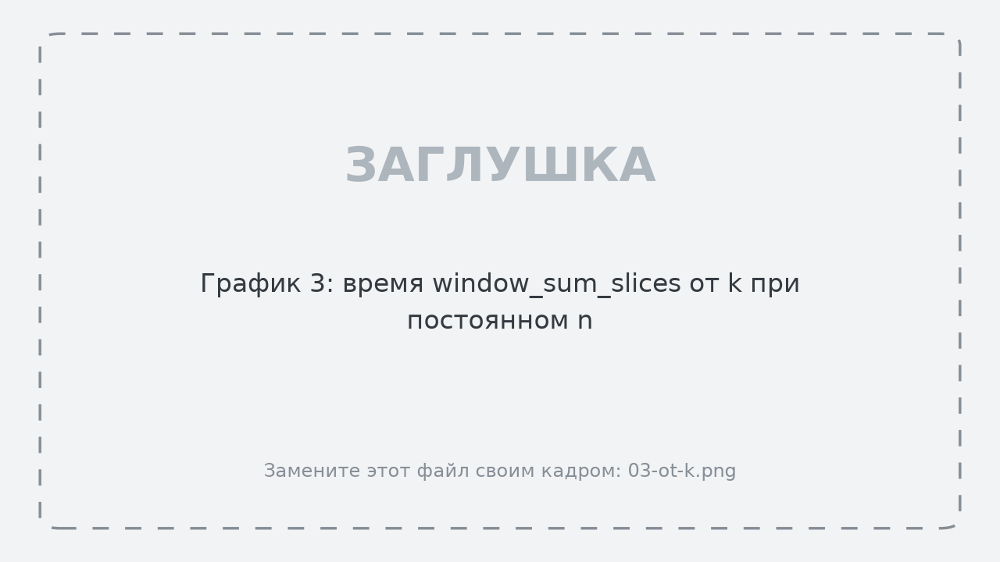
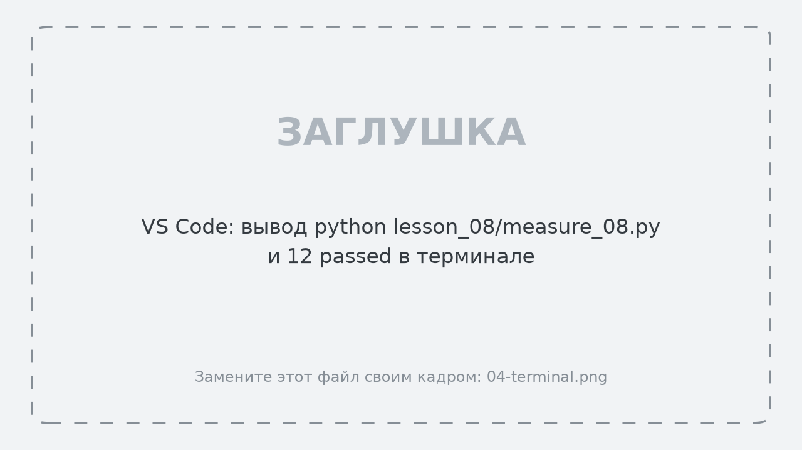

# Домашняя работа № 8 · Сложность по замерам и графикам

**Дисциплина:** ОП.04 «Основы алгоритмизации и программирования»

| Поле | Значение |
|---|---|
| Фамилия, имя, отчество |  |
| Группа |  |
| Номер работы | 8 |
| Тема работы | Замер пяти функций, рост при удвоении, графики |
| Дата сдачи |  |
| Ветка | `hw-08` |

Часть отчёта уже заполнена. Замените `___` своими данными.

**Компьютер:** процессор ___, Python ___, система ___.

---

## 1. Прогноз до замера

Заполните до запуска `measure_08.py`, по описаниям функций (docstring), не
вчитываясь в код. Ошибиться можно: в разделе 3 вы сравните прогноз с замером.

| Функция | Что делает | Прогноз сложности |
|---|---|---|
| `window_sum_slices` | лучшая сумма окна, каждое окно складывается срезом | ___ |
| `window_sum_shift` | лучшая сумма окна, окно сдвигается | O(n): один проход, на каждом шаге прибавить и вычесть по числу |
| `merge_intervals` | объединение интервалов | ___ |
| `unique_in_order_list` | элементы без повторов, порядок первого появления | ___ |
| `unique_in_order_set` | то же, с множеством | ___ |

Во всех замерах числа в списке не повторяются. Длина окна k = n / 2.

---

## 2. Замер

### 2.1. Время, секунды

Перенесите из вывода `measure_08.py`.

| Функция | n = 1 000 | 2 000 | 4 000 | 8 000 | 16 000 |
|---|---|---|---|---|---|
| `window_sum_slices` | ___ | ___ | ___ | ___ | ___ |
| `window_sum_shift` | ___ | ___ | ___ | ___ | ___ |
| `merge_intervals` | ___ | ___ | ___ | ___ | ___ |
| `unique_in_order_list` | ___ | ___ | ___ | ___ | ___ |
| `unique_in_order_set` | ___ | ___ | ___ | ___ | ___ |

### 2.2. Рост при удвоении

| Функция | 1 000 → 2 000 | → 4 000 | → 8 000 | → 16 000 | Сложность по замеру |
|---|---|---|---|---|---|
| `window_sum_slices` | ___ | ___ | ___ | ___ | ___ |
| `window_sum_shift` | ___ | ___ | ___ | ___ | ___ |
| `merge_intervals` | ___ | ___ | ___ | ___ | ___ |
| `unique_in_order_list` | ___ | ___ | ___ | ___ | ___ |
| `unique_in_order_set` | ___ | ___ | ___ | ___ | ___ |

### 2.3. Графики

На обычных осях три быстрые функции почти сливаются с нулём. Почему так
получилось: ___

На логарифмических осях линии стали прямыми. Какие линии идут круче остальных
и что это значит: ___

---

## 3. Сверка с кодом

### 3.1. Прогноз и замер

В каких функциях прогноз из раздела 1 совпал с замером, а в каких нет: ___

### 3.2. Можно ли отличить O(n) от O(n log n)

У `merge_intervals` сортировка, у `window_sum_shift` один проход. Рост при
удвоении у них: ___ и ___. Можно ли по пяти точкам уверенно сказать,
что одна функция O(n log n), а другая O(n), и что помогло бы сказать точнее: ___

### 3.3. Загадочная функция

`unique_in_order_list` — всего один цикл по списку, но замер показывает ___.
Строка кода, которая за это отвечает: ___

Почему эта строка не O(1) (вспомните модуль 17): ___

Сколько секунд заняла бы `unique_in_order_list` на 1 000 000 чисел?
Посчитайте от своего времени при n = 16 000:

1 000 000 / 16 000 ≈ 62,5 — во столько раз больше n;
время вырастет примерно в 62,5² ≈ 3 900 раз;
___ с × 3 900 ≈ ___ с ≈ ___ мин.

Во сколько раз быстрее на том же n = 16 000 работает `unique_in_order_set`: ___

### 3.4. Время от длины окна

На графике 3 n = 10 000 не меняется, меняется только k. Опишите форму графика: ___

Сколько окон и сколько сложений в каждом окне при k = 1, k = 5 000 и k = 10 000:

| k | Окон: n − k + 1 | Чисел в каждом окне | Всего сложений, примерно |
|---|---|---|---|
| 1 | 10 000 | 1 | 10 000 |
| 5 000 | ___ | ___ | ___ |
| 10 000 | ___ | ___ | ___ |

Почему при k = n срезы снова работают быстро: ___

Какая сложность у `window_sum_slices`, если записать её через n и k: ___

Почему в замере раздела 2 эта функция вела себя как O(n²): ___

---

## 4. Вывод

Три фразы: что вы узнали о функциях из замера, чего не было видно по коду,
и чему верить, если замер и прогноз расходятся.

___

---

ИИ: не использовал / использовал для ___
