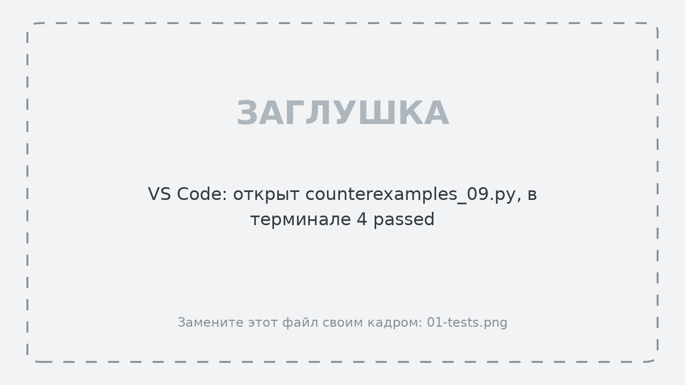

# Домашняя работа № 9 · Шесть кандидатов, одна задача

**Дисциплина:** ОП.04 «Основы алгоритмизации и программирования»

| Поле | Значение |
|---|---|
| Фамилия, имя, отчество |  |
| Группа |  |
| Номер работы | 9 |
| Тема работы | Разбор шести решений задачи «повтор рядом» |
| Дата сдачи |  |
| Ветка | `hw-09` |

Часть бланка уже заполнена. Замените `___` своими ответами.
Время и память оценивайте через n (длина списка) и k.

---

## 1. Чтение решений

Заполните до запуска гонки.

| Решение | Идея | Время | Доп. память | Верно? |
|---|---|---|---|---|
| A | для каждого прохода проверить следующие k проходов вложенным циклом | O(n·k) | O(1) | да |
| B | ___ | ___ | ___ | ___ |
| C | ___ | ___ | ___ | ___ |
| D | ___ | ___ | ___ | ___ |
| E | ___ | ___ | ___ | ___ |
| F | ___ | ___ | ___ | ___ |

В решении B нет вложенного цикла `for`. Где в нём спрятан второй цикл: ___

Что хранит словарь в C и множество в D: ___

---

## 2. Две ошибки

### 2.1. Первое ошибочное решение: ___

Контрпример: `nums = ___`, `k = ___`.
Правильный ответ: ___, решение отвечает: ___.

Трассировка: значения переменных на каждом шаге цикла.

| i | x | состояние словаря или множества после шага | что вернули |
|---|---|---|---|
| 0 | ___ | ___ | — |
| ___ | ___ | ___ | ___ |

Какая строка виновата и как её исправить: ___

### 2.2. Второе ошибочное решение: ___

Контрпример: `nums = ___`, `k = ___`.
Правильный ответ: ___, решение отвечает: ___.

| i | x | состояние после шага | что вернули |
|---|---|---|---|
| 0 | ___ | ___ | — |
| ___ | ___ | ___ | ___ |

Какая строка виновата и как её исправить: ___

### 2.3. Как я искал

Нашёл ошибки чтением кода / стресс-тестом / и так и так: ___

Прогоните оба ошибочных решения по трём примерам из условия. Какое из них
ошибается уже там, а какое проходит все три. Чего не хватает в примерах,
чтобы поймать второе: ___

Команда `pytest lesson_09 -q` показала: `___ passed`.

---

## 3. Гонка

Перенесите вывод `race_09.py`, n = 5 000.

| Решение | k = 10 | k = 100 | k = 1 000 | k = 5 000 |
|---|---|---|---|---|
| A | ___ | ___ | ___ | ___ |
| B | ___ | ___ | ___ | ___ |
| C | ___ | ___ | ___ | ___ |
| D | ___ | ___ | ___ | ___ |
| E | ___ | ___ | ___ | ___ |
| F | ___ | ___ | ___ | ___ |

У каких решений время растёт вместе с k, а у каких почти не меняется.
Совпадает ли это с таблицей раздела 1: ___

A и B оба O(n·k), но одно из них заметно быстрее. Какое, во сколько раз
и почему, если сложность одинаковая: ___

При k = 1 000 и k = 5 000 время A растёт меньше чем в 5 раз. Почему
(подсказка: сколько следующих проходов реально есть у каждого i): ___

---

## 4. Решение интервьюера

Рейтинг верных решений: от лучшего к худшему, с причиной.

| Место | Решение | Почему |
|---|---|---|
| 1 | ___ | ___ |
| 2 | ___ | ___ |
| 3 | ___ | ___ |
| 4 | ___ | ___ |

C и D работают за O(n). Когда бы вы выбрали D, а не C: ___

Что вы сказали бы кандидатам E и F на собеседовании, не называя ответа.
Какой тест вы бы им предложили проверить: ___

---

ИИ: не использовал / использовал для ___
