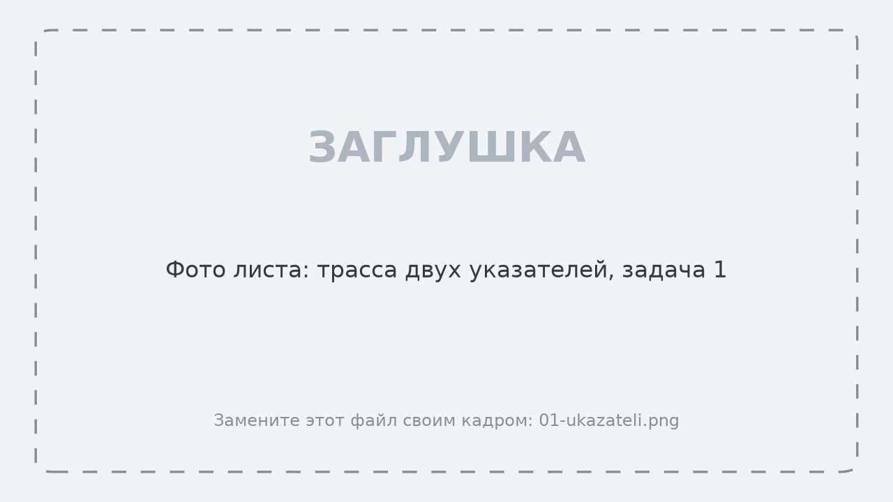
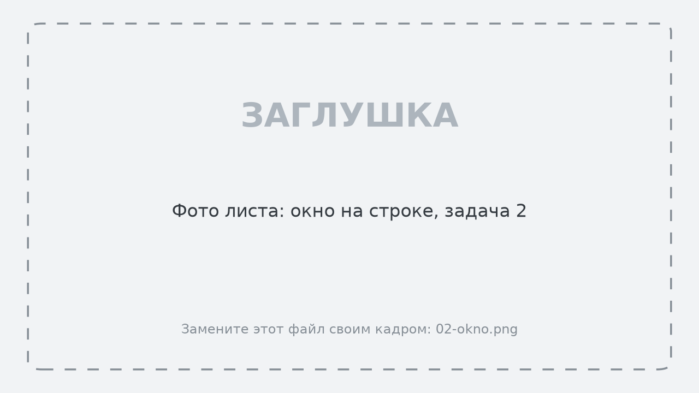
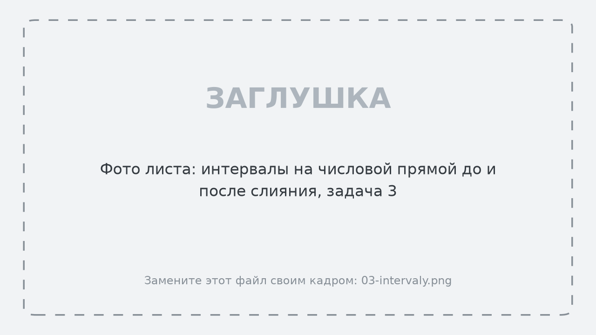

# Домашняя работа № 10 · Трассировка на бумаге

**Дисциплина:** ОП.04 «Основы алгоритмизации и программирования»

| Поле | Значение |
|---|---|
| Фамилия, имя, отчество |  |
| Группа |  |
| Номер работы | 10 |
| Тема работы | Ручная трассировка: указатели, окно, интервалы, кэш |
| Дата сдачи |  |
| Ветка | `hw-10` |

Первые строки таблиц заполнены как образец. Замените `___` своими данными,
добавьте строки, если шагов больше.

---

## 1. Пара с суммой

`nums = [1, 3, 4, 6, 8, 11]`, `target = 10`

| Шаг | left | right | nums[left] + nums[right] | Действие |
|---|---|---|---|---|
| 1 | 0 | 5 | 1 + 11 = 12 | больше 10 → `right -= 1` |
| 2 | 0 | 4 | 1 + 8 = 9 | меньше 10 → `left += 1` |
| 3 | ___ | ___ | ___ | ___ |
| ___ | ___ | ___ | ___ | ___ |

Ответ функции: ___. Сколько шагов цикла: ___.

Почему, когда сумма больше `target`, можно сдвинуть `right` и больше никогда
не рассматривать `nums[right]`: ___

---

## 2. Самая длинная подстрока без повторов

`s = "abcbdeca"`

| right | ch | Убрал `while` | left | Окно `s[left:right+1]` | best |
|---|---|---|---|---|---|
| 0 | a | — | 0 | a | 1 |
| 1 | b | — | 0 | ab | 2 |
| 2 | c | — | 0 | abc | 3 |
| 3 | b | ___ | ___ | ___ | ___ |
| 4 | ___ | ___ | ___ | ___ | ___ |
| 5 | ___ | ___ | ___ | ___ | ___ |
| 6 | ___ | ___ | ___ | ___ | ___ |
| 7 | ___ | ___ | ___ | ___ | ___ |

Ответ функции: ___, подстрока: ___.

На шаге `right = 3` цикл `while` убирает больше одной буквы. Почему нельзя
убрать только саму букву `b`: ___

Внутри `for` есть `while`. Почему время всё равно O(n): сколько раз за всю
работу каждая буква может попасть в окно и выйти из него: ___

---

## 3. Объединение интервалов

После сортировки: ___

| Интервал | Пересекается с последним в ответе? | Ответ после шага |
|---|---|---|
| [1, 3] | ответ пуст | [[1, 3]] |
| [2, 6] | ___ | ___ |
| ___ | ___ | ___ |
| ___ | ___ | ___ |
| ___ | ___ | ___ |
| ___ | ___ | ___ |

Ответ функции: ___

Интервалы `[15, 18]` и `[18, 20]` касаются в одной точке. Какое условие
в коде решает, сливать ли их, и что изменить, чтобы касание не считалось
пересечением: ___

---

## 4. LRU и FIFO, кэш на 3 места

Порядок в кэше записывайте от самого старого к самому новому.

### 4.1. LRU

| Запрос | Результат | Вытеснен | Кэш после запроса |
|---|---|---|---|
| put a 1 | — | — | a |
| put b 2 | — | — | a, b |
| put c 3 | — | — | a, b, c |
| get a | 1, попадание | — | b, c, a |
| put d 4 | ___ | ___ | ___ |
| get b | ___ | ___ | ___ |
| get c | ___ | ___ | ___ |
| put e 5 | ___ | ___ | ___ |
| get a | ___ | ___ | ___ |
| get d | ___ | ___ | ___ |

Попаданий из пяти `get`: ___

### 4.2. FIFO

| Запрос | Результат | Вытеснен | Кэш после запроса |
|---|---|---|---|
| put a 1 | — | — | a |
| put b 2 | — | — | a, b |
| put c 3 | — | — | a, b, c |
| get a | 1, попадание | — | a, b, c |
| put d 4 | ___ | ___ | ___ |
| get b | ___ | ___ | ___ |
| get c | ___ | ___ | ___ |
| put e 5 | ___ | ___ | ___ |
| get a | ___ | ___ | ___ |
| get d | ___ | ___ | ___ |

Попаданий из пяти `get`: ___

### 4.3. Что получилось

Какая политика выиграла на этой последовательности и на каком запросе
они разошлись впервые: ___

В модуле 20 LRU на большом потоке запросов давал больше попаданий, чем FIFO.
Почему здесь вышло иначе и что из этого следует: ___

---

ИИ: не использовал / использовал для ___
